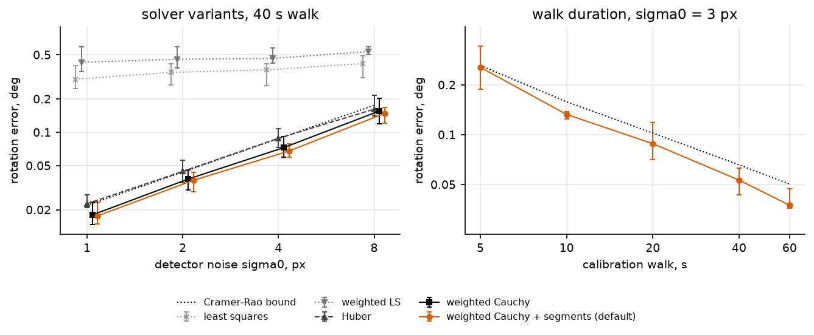
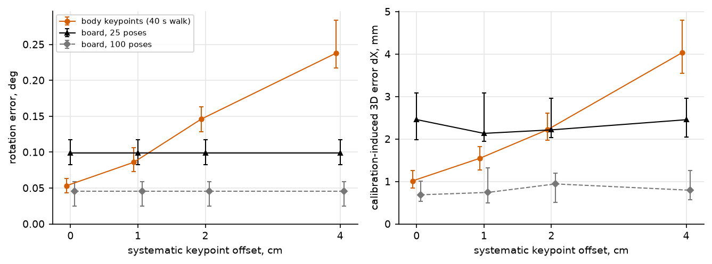

# posecalib

**Extrinsic calibration of a static multi-camera rig from the body keypoints of one moving person. No calibration board.**

Markerless motion capture triangulates 2D keypoints from several cameras, which requires the position and orientation
of every camera. The usual way to obtain them is to wave a checkerboard or ChArUco board in front of all cameras.
`posecalib` uses the person instead: a pose detector returns the same ordered set of keypoints in every view, so
cross-view correspondences are known without feature matching. A 20–40 s walk across the capture area gives
thousands of them, spread over the whole working volume. They are noisier than board corners, but a robust weighted
bundle adjustment estimates camera positions and orientations from these observations.

```python
from posecalib import calibrate, align_to_floor

# keypoints: (cameras, frames, 17, 2) COCO-17 pixels, NaN if missing; confidence: (cameras, frames, 17)
calib = calibrate(keypoints, confidence, K, camera_distance=(0, 1, 5.32))   # metres between cameras 0 and 1
calib = align_to_floor(calib)        # z up, floor at z = 0

calib.R, calib.t                     # world-to-camera extrinsics, (C,3,3) and (C,3)
calib.reprojection_rmse              # per-camera RMS reprojection error, px
calib.save_json('rig.json')
```

## How it works

1. **Correspondences from semantics.** Keypoint *j* in synchronised frame *f* identifies the same body landmark across cameras.
   Observations below a confidence threshold are dropped.
2. **Pairwise geometry.** For every camera pair, the relative pose is estimated from confident correspondences:
   normalised 8-point essential matrix inside LMedS, local optimisation on Sampson distances, and a homography
   test that pushes near-planar (degenerate) pairs to the end of the queue.
3. **Incremental growth.** Starting from the pair with the best *inliers × sin(triangulation angle)*, points are
   triangulated robustly, the remaining cameras are added by robust PnP, and a local bundle adjustment runs after
   every camera.
4. **Global bundle adjustment.** Cameras and points are refined together by an M-estimator (Cauchy loss via
   iteratively reweighted least squares) with observation weights from detector confidence and an optional term
   that keeps each body segment at a constant length across frames. Sparse analytic Jacobian, SciPy trust-region
   solver. Focal lengths can be refined as well.
5. **Metric scale.** Images alone do not determine absolute scale. It is fixed by one measurement: the distance between two cameras
   (recommended) or measured segment lengths of the person. `align_to_floor` fits the floor robustly to the ankle
   trajectory.

## Installation

```bash
pip install git+https://github.com/NewArtY/posecalib.git
# or, for development
git clone https://github.com/NewArtY/posecalib.git
cd posecalib
pip install -e ".[dev]"
```

Dependencies: NumPy and SciPy (Matplotlib only for the benchmark figures). Python 3.9+.

The package takes precomputed keypoint detections. Video capture, camera synchronisation,
pose detection and lens-distortion correction are handled separately.

## Input requirements

| | |
|---|---|
| Cameras | static and synchronised; any number ≥ 2 (tested with 4) |
| Intrinsics | known: `K` per camera, images undistorted (calibrate intrinsics once, e.g. with OpenCV) |
| Keypoints | COCO-17 layout (OpenPose, MMPose/RTMPose, YOLO-pose, …); other layouts via a custom `Skeleton` |
| People | exactly one person in view during the calibration walk |
| Scale | one measured length: distance between two camera centres, or limb lengths of the person |

`examples/calibrate_npz.py` calibrates from a `.npz` file with `keypoints`, `confidence` and `K` arrays.

## Recording the calibration walk

* 20–40 s, one person in the area;
* walk across the whole area (around the perimeter and in a zigzag), turn around, raise, spread and extend the arms,
  so that keypoints fill the volume in width and height and every camera sees the body from several sides;
* standing in place is not enough: the points then occupy a small volume and the problem becomes ill-conditioned.

## Accuracy in simulation

Four cameras on a circle of radius 3.5–4 m around a 4 × 4 m area, 1080p, a person walking with arm movements;
the simulated detector has confidence-dependent noise, 3 % outliers and 2 % left/right swaps
(`benchmarks/run_benchmark.py`, median over 10 random scenes).

**Detector noise** (40 s walk, default solver). *dX* is the 3D error that the calibration itself adds: the mean
displacement of test keypoints when the true cameras are replaced by the estimated ones (scale from the distance
between two cameras measured with 5 mm error). *MPJPE* is the triangulation error with perfect cameras, i.e. the
error the detector noise causes anyway.

| detector noise σ₀ | camera rotation error | Cramér–Rao bound | dX | MPJPE |
|---|---|---|---|---|
| 1 px | 0.018° | 0.022° | 0.5 mm | 8 mm |
| 2 px | 0.037° | 0.044° | 0.7 mm | 16 mm |
| 4 px | 0.068° | 0.088° | 1.2 mm | 30 mm |
| 8 px | 0.148° | 0.175° | 2.5 mm | 54 mm |

In these simulations, calibration-induced displacement is small relative to the triangulation error.
The rotation errors and Cramér–Rao reference values have a similar order of magnitude; the reported median
errors do not establish statistical efficiency.
Plain least squares, by contrast, gives 0.3–0.5° at any noise level: a robust loss is essential.



**Walk duration** (σ₀ = 3 px): 0.26° after 5 s, 0.13° after 10 s, 0.09° after 20 s, 0.05° after 40 s, 0.04° after
60 s. Standing in place for 40 s instead of walking gives 0.30°.

**Systematic keypoint offsets vs a calibration board.** The board is simulated favourably: 7 × 5 squares of 6 cm,
every visible corner detected with 0.3 px noise, no bias.

| systematic offset | keypoints: rotation / dX | board, 25 poses: rotation / dX | board, 100 poses: rotation / dX |
|---|---|---|---|
| 0 cm | 0.053° / 1.0 mm | 0.099° / 2.5 mm | 0.046° / 0.7 mm |
| 1 cm | 0.086° / 1.6 mm | 0.099° / 2.1 mm | 0.046° / 0.7 mm |
| 2 cm | 0.146° / 2.2 mm | 0.099° / 2.2 mm | 0.046° / 0.9 mm |
| 4 cm | 0.238° / 4.0 mm | 0.099° / 2.5 mm | 0.046° / 0.8 mm |



In this simulation, without systematic offsets, a 40 s walk has about half the rotation error of a short board session and is comparable to a long
one. The keypoint method degrades as view-dependent detector bias grows, which noise averaging cannot remove.

## Limitations

* **Systematic detector bias sets the accuracy limit.** Random keypoint noise averages out; consistent
  view-dependent offsets (e.g. where different views place the hip joint) do not. A low reprojection error on body
  keypoints does not prove the geometry is right: check the calibration on independent data (a reference length,
  leave-one-camera-out reprojection on a separate recording, or a board).
* Synchronised cameras and known intrinsics are assumed; a single person must be in view.
* The benchmark is synthetic; on a real rig the detector's systematic error has to be measured.

## Repository layout

```
src/posecalib/          library
    api.py              calibrate(), Calibrator, Calibration, triangulate(), align_to_floor()
    initialization.py   pairwise poses, incremental growth
    bundle.py           bundle adjustment and IRLS refinement
    geometry.py         two-view geometry, robust triangulation, PnP
    sim/                synthetic scenes: cameras, walking person, detector model, board baseline
benchmarks/             simulation benchmark
examples/               quick start on synthetic data, calibration from a .npz file
tests/                  pytest suite
```

```bash
pytest                                     # tests (about 20 s)
python examples/synthetic_quickstart.py    # end-to-end example (under a minute)
python benchmarks/run_benchmark.py         # full benchmark (about 30 min on 14 workers; hardware-dependent)
```

## License

MIT
